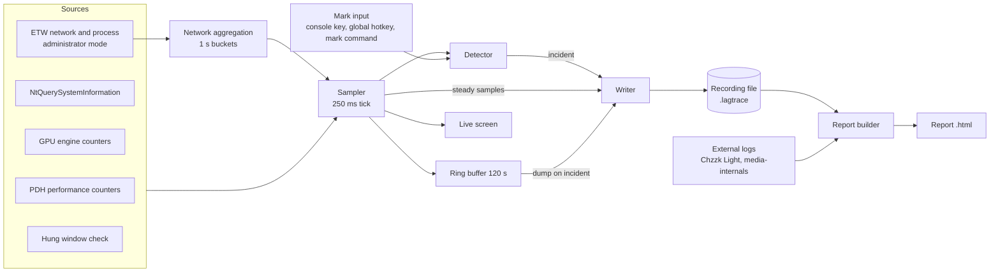

# Architecture

This document defines the structure from collection to storage and reports, the thread model, crate boundaries, and how the tool manages its own overhead. What is collected is in [Metrics](metrics.md), and when something counts as an incident is in [Detection and likely causes](detection.md).

## Overall structure



## Run modes

| Mode | Rights | Collected | How to enter |
| --- | --- | --- | --- |
| Standard | Standard user | Everything except network detail and ETW process events | Default |
| Administrator | Administrator | Everything | `A` on the live screen, or run as administrator |
| Headless | Either | Same as the mode above | `record --headless`. Records without the live screen |

Restarting as administrator starts a new recording and closes the previous file as it is. If rights changed inside one file, it would be hard to tell which items existed in which time span.

## Thread model

| Thread | Role | Interval or trigger | Notes |
| --- | --- | --- | --- |
| Sampler | Calls sources, updates the ring buffer, runs the detector | High-resolution waitable timer, 250 ms | Measures its actual wake-up time on every tick to detect hitches |
| ETW consumer | Receives network and process events and aggregates them into 1 s buckets | Events | Starts only in administrator mode |
| Writer | Writes to SQLite | One transaction every 5 s, incidents immediately | Fed by a bounded channel. When it falls behind, steady samples are thinned first |
| Screen | Draws the live screen and handles keys | 1 s | Reads only the latest snapshot |
| Window messages | Hidden top-level window, `RegisterHotKey`, session end messages | Messages | Sends marks to the detector and shutdown signals to the writer |
| Command listener | Named pipe `\\.\pipe\lag-tracker-<hash of user SID>` | Connections | Receives `lag-tracker mark`. Whether a standard-user command can reach an administrator recording needs verification |

- The sampler never waits for another thread while collecting. The writer and the screen are decoupled through channels and snapshots.
- Shutdown signals arrive on two paths. Both ask the writer for a final write, limited to two seconds so it finishes within the grace period Windows allows.
  - Closing the console window (`CTRL_CLOSE_EVENT`) and `Ctrl+C`: `SetConsoleCtrlHandler`
  - Log off and system shutdown: `WM_QUERYENDSESSION` and `WM_ENDSESSION` on a hidden top-level window. A console program that uses user32 does not receive these two events through its console handler. A message-only window (`HWND_MESSAGE`) does not receive this broadcast either, so the tool uses an ordinary invisible top-level window.

## Process settings

At startup the tool opts out of Windows power throttling. Without this, hitch detection does not work.

- Windows 10 1709 and later, and Windows 11, may apply power throttling (EcoQoS) to processes whose window is not in the foreground: they can be moved to efficiency cores and slowed down. Windows 11 may also ignore timer resolution requests from minimized or occluded windows.
- Recording with the console window minimized is the normal way to use the tool. Without the opt-out, **the tool itself is throttled**, its timer wakes late, and that lateness is miscounted as a system hitch. The sampler would also run last at exactly the load spikes it is meant to measure.
- So the tool calls `SetProcessInformation(ProcessPowerThrottling)` with `PROCESS_POWER_THROTTLING_EXECUTION_SPEED` and `PROCESS_POWER_THROTTLING_IGNORE_TIMER_RESOLUTION` set in `ControlMask` and an empty `StateMask`, which opts out of both.
- Process priority stays normal. Opting out of throttling and raising priority are different settings ([Hitch detection](detection.md#hitch-detection)).
- If the call fails (for example on an unsupported OS), the tool records a `tool_event`, and the report adds a "tool throttling opt-out failed" caution to its hitch interpretation.

## Tick plan

Not every source runs on every tick. Expensive sources run on longer intervals.

| Source | Interval | Ring buffer resolution | Steady storage |
| --- | --- | --- | --- |
| System PDH counters (CPU, DPC, clock, memory, disk) | 250 ms | 250 ms | 1 s average and peak |
| Process table (NtQuery) | 500 ms | 500 ms | 1 s, selected processes only |
| GPU engines and GPU memory | 1 s | 1 s | 1 s |
| Hung windows | 1 s | 1 s | Only on state changes |
| Network aggregation (ETW) | 1 s buckets | 1 s | 1 s |

GPU engine counters can be expensive because they have many instances. The first implementation measures their real cost and, if it exceeds the budget, lengthens their interval as described in [Degradation](#degradation). The `D3DKMTQueryStatistics` path that Task Manager uses is the alternative to evaluate.

## Crate layout

A Cargo workspace separates OS-dependent code from decision logic, so that the logic can be tested with synthetic data.

```text
lag-tracker/
├── Cargo.toml                 # workspace
└── crates/
    ├── lag-core/              # OS-independent: data model, ring buffer, detection rules, likely causes, external log parsers
    ├── lag-win/               # Windows only: PDH, NtQuery, GPU, ETW, hotkey, console control, rights
    └── lag-tracker/           # executable: CLI, live screen, writer (SQLite), report builder
```

- `lag-core` does not depend on the `windows` crate. It receives time as a monotonic clock value plus a UTC anchor.
- Sources in `lag-win` implement one trait (for example `Source::collect(&mut self, tick) -> Result<Sample>`). When one source fails, the others keep running.
- Storage and reports start as modules of the executable crate and are split out when they grow.

## Dependency candidates

Versions are pinned at implementation time. A new dependency is added only after confirming a real use and checking for a smaller alternative.

| Purpose | Candidate | Notes |
| --- | --- | --- |
| Win32 API | `windows` | PDH, processes, threads, console, hotkey |
| ETW | `ferrisetw` | Real-time sessions in administrator mode |
| Storage | `rusqlite` (bundled) | Single file, no extra runtime |
| Live screen | `ratatui` + `crossterm` | Handles the display width of Korean text |
| CLI | `clap` | |
| Channels | `crossbeam-channel` | Bounded channels |
| Serialization | `serde`, `serde_json`, `toml` | External logs, settings |
| Capture compression | `lz4_flex` | Pure Rust, fast block compression. Dropped in favor of raw storage if Phase 1 measurements show little benefit |
| Report charts | uPlot (MIT, JavaScript) | Embedded in the report HTML, opens without network access. Needs a license notice |
| Localization | Plain string tables in `lag-core` | English and Korean. A localization crate only if plurals or formatting outgrow simple tables |

## Time base

- Order and intervals are measured with the monotonic clock (QPC).
- Stored timestamps are UTC epoch milliseconds. At start the tool stores the mapping between QPC and system time as an anchor, and stores a new anchor when the system time jumps by more than one second.
- Chzzk Light diagnostics use epoch milliseconds, and media-internals uses a creation time (UTC) plus relative seconds, so both can be placed on the same axis.
- After resume from sleep the timer wakes very late. Sleep spans are detected from power events and the difference between the monotonic clock and system time, marked separately, and never counted as hitches.

## Process identity

- PIDs are reused, so the process key is `(PID, creation time)`.
- Executable names are stored without their path.
- For Chrome-family executables (`chrome.exe`, `msedge.exe`, `whale.exe`), only the `--type=` and `--utility-sub-type=` values are read from the command line and turned into a role. The command line itself is never stored.
- The command line is read with `NtQueryInformationProcess` and `ProcessCommandLineInformation`. If access is denied, the role is "unknown".

## Degradation

The tool must not cause lag, so it reduces its own work when its overhead exceeds the budget.

1. The sampler measures its own processing time on every tick.
2. When the average over the last 30 seconds exceeds the budget (2% of the tick interval), the most expensive source has its interval doubled first. The order is GPU engines, hung windows, then the process table.
3. The changed interval and the reason are stored as an event in the recording and shown on the live screen.
4. Intervals are not restored automatically when load drops. A recording whose resolution keeps changing is hard to compare.

## Error handling

| Situation | Behavior |
| --- | --- |
| A performance counter is missing or corrupted | Turn off only that item and keep recording. `doctor` explains the fix (`lodctr /r`) |
| No administrator rights | Turn off network detail and show the reason on screen |
| An ETW session left behind by a previous run | Stop the session with the same name at start and create it again |
| Hotkey registration fails (another program uses it) | The console key and the `mark` command keep working. The screen shows "hotkey unavailable" |
| Disk full or write failure | Keep the ring buffer without stopping, warn on screen, and resume writing when space frees up |
| Writer channel is full | Thin steady samples to two-second spacing. Incident data is never dropped |

## Build and distribution

- Build with Rust stable for the MSVC target (`x86_64-pc-windows-msvc`). Link the C runtime statically so the executable runs without extra installs.
- The package is one zip with the executable and short usage instructions in English and Korean.
- Without code signing, SmartScreen may warn on first run. The usage instructions include the "More info, then Run anyway" steps.
- A tool that reads process information and uses ETW may trigger antivirus false positives. Each release publishes hashes, and the documentation explains how to report a false positive.
