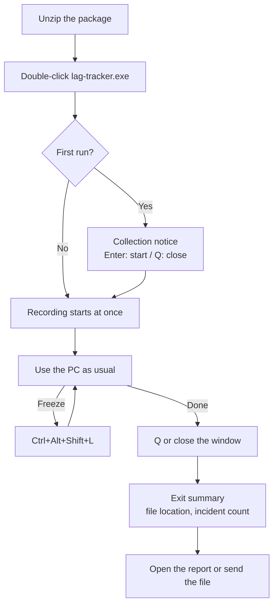

# UI/UX

This document defines what users see and read from launch through recording, marking, exit, and the report. User types follow [Users in the overview](overview.md#users).

## Design principles

1. **Defaults all the way**: double-clicking the executable starts recording with no setup. Only command-line users need to know the options.
2. **State is always visible**: whether it is recording, for how long, where the file is saved, and what is missing always sit at the top of the screen.
3. **One thing to do on a freeze**: remember one hotkey. It is always shown at the bottom of the screen.
4. **Never in the way**: no sounds, pop-ups, or focus stealing by default. If the tool jumped above other windows, it would change the very situation the user is in.
5. **Verdicts are candidates with evidence**: instead of "the cause is X", show "X crossed its threshold and Y increased the most".
6. **Privacy notice first**: the tool runs on other people's PCs, so it states what it collects before it starts.

## Language

- The live screen, report, and package instructions ship in English and Korean.
- The language follows the Windows display language: Korean when it is Korean, English otherwise. `--lang en` or `--lang ko` overrides it.
- Strings live in per-language tables in `lag-core` and are never assembled from fragments, so word order stays natural in both languages.
- The report stores the language it was built in. Rebuilding with `report --lang` switches it.
- Examples in this document are shown in English.

## User flow



## First-run screen

Shown once, on the first run. Consent is stored in `%LOCALAPPDATA%\lag-tracker\settings.toml`. A `--headless` run has no screen to confirm on, so without stored consent it starts only when `--accept-notice` is given. With neither, it prints the notice and exits with code 1.

```text
 lag-tracker 0.1.0

 Records how this PC uses its resources to find what causes lag and freezes.

 Recorded       CPU, memory, GPU, and disk usage, names of running programs
 Not recorded   Window titles, file and document contents, the screen, visited addresses, accounts
 Saved to       C:\Tools\lag-tracker\records\
 Sending        Nothing is sent automatically. Files leave this PC only when you send them

 When the PC freezes, press Ctrl+Alt+Shift+L. It works from any program.

 Enter  Start recording    Q  Close
```

## Live screen

Drawn in one console window, redrawn every second, at least 80 columns wide. At 100 columns or more, the process table shows more columns.

```text
 lag-tracker  ● Recording 01:12:34   records\lag-20261017-201530.lagtrace (8.2 MB)
 Standard user: network detail off (A to restart as administrator)
───────────────────────────────────────────────────────────────────────────────
 CPU      ███████▉░░  79%  busiest core 100%  queue 6    clock 92%
 Memory   ██████░░░░  61%  available 6.2 GB   hard faults 12/s
 GPU      3D 34%  video decode 41%            disk 4%  latency 18 ms
 Network  ↑ 0.2 Mbps ↓ 9.8 Mbps                tool overhead 0.3%
───────────────────────────────────────────────────────────────────────────────
 Top processes (Tab to change sort: CPU)                       CPU   Memory   GPU
 chrome.exe  Renderer                                        31.2%  1.2 GB    3%
 chrome.exe  GPU                                             18.4%  0.6 GB   38%
 chrome.exe  Renderer                                        12.0%  0.9 GB    1%
 Discord.exe                                                  4.1%  0.4 GB    0%
 Other (182)                                                  9.6%  6.8 GB    0%
───────────────────────────────────────────────────────────────────────────────
 Recent incidents
 ▲ 20:27:16  auto  CPU saturation 4.2 s   Chrome renderers (2) +38 pp
 ■ 20:33:12  mark  "video froze"          GPU video decode 98%
───────────────────────────────────────────────────────────────────────────────
 Ctrl+Alt+Shift+L mark from anywhere   Space mark here   R report   O folder   Q quit
```

- **State colors**: default color when normal, yellow for caution, red when over a threshold. Values over a threshold also get a `▲` prefix so color is never the only signal.
- **Incident symbols**: automatic `▲`, mark `■`, hitch `◆`. A symbol always comes with text.
- **Tool overhead** is always visible, so users can check right away whether the tool itself is slowing the PC.
- **During degradation** the status line shows, for example, `GPU sampling reduced to every 2 s (tool overhead control)`.
- Recording continues while the window is minimized. Only drawing is skipped.

### Keys

| Key | Action |
| --- | --- |
| `Ctrl+Alt+Shift+L` | Mark a freeze from anywhere (global hotkey) |
| `Space` | Mark from this window. A note can follow, Enter skips it |
| `Tab` | Cycle the process table sort: CPU, memory, GPU |
| `R` | Build a report from the recording so far and open it in the browser |
| `O` | Open the recording folder with the file selected |
| `A` | Restart as administrator |
| `?` | Help: a one-line explanation of each metric |
| `Q` | Confirm exit |

The most frequent action, marking, uses `Space` because it is large and easy to hit. Sorting cycles with a single key to reduce the number of keys to remember.

The default global hotkey is a four-key chord that is unlikely to clash with other programs. If it is awkward to press during a freeze, `--hotkey Pause` switches to a single key. `Pause` is rarely bound, but many laptops lack it, so it is not the default.

### Feedback when marking

| Input | Feedback |
| --- | --- |
| Mark from this window | A line is added to recent incidents at once, and the bottom shows `Marked 20:33:12 · note (Enter to skip):` |
| Global hotkey | The console window title becomes `lag-tracker ■ Marked 20:33:12` for 10 seconds, and the taskbar button flashes three times |

The global hotkey is pressed while another program is in use, so feedback goes only to the taskbar, without sounds or pop-ups. Flashing may not work when Windows Terminal hosts the console. Phase 1 verifies this.

## Exit

```text
 Stop recording?  Y stop   N continue

 ✓ Saved

 Duration    2 h 14 min
 Incidents   7 auto · 3 marks · 2 hitches
 File        C:\Tools\lag-tracker\records\lag-20261017-201530.lagtrace (31 MB)
 Report      C:\Tools\lag-tracker\records\lag-20261017-201530.html

 Enter open report   O open folder   any other key close
 To send this to someone, the .lagtrace file is all they need.
```

- Closing the window with its X button also saves. The window then closes without the summary, and the next run shows `Previous recording saved: <file>` on its first line.
- If building the report takes a while, a progress indicator is shown. Saving the recording always finishes first.

## Administrator rights

- The default is standard rights. Only network detail and short-lived process detection need administrator rights.
- `A` brings up the UAC prompt. If approved, a new administrator window opens and the current recording is saved and closed. The screen says beforehand: `The current recording will be saved and a new one will start as administrator.`
- If UAC is declined, the current recording simply continues.

## When already running

A second launch does not start a new recording. It shows:

```text
 Already recording (01:12:34, records\lag-20261017-201530.lagtrace)
 Space mark now   W bring the recording window forward   Q close this window
```

## Status and error messages

| Situation | Message | Where |
| --- | --- | --- |
| Corrupted performance counters | `Some metrics cannot be read and are skipped: disk. Run lag-tracker doctor for a fix` | Status line |
| Hotkey unavailable | `Another program is using Ctrl+Alt+Shift+L. Press Space in this window to mark` | Replaces the bottom hint |
| Disk almost full | `Not enough disk space. Keeping only the last 2 minutes until space frees up` | Status line, red |
| Overhead control | `GPU sampling reduced to every 2 s (tool overhead control)` | Status line |
| Resume from sleep | A `Sleep 20:40 to 21:05` line | Incident list |
| Capture limit reached | `Capture limit (20 minutes per hour) reached. Keeping summaries only` | Status line |

## Report

A single HTML file that opens in the browser. It makes no network requests; the chart library and the data are embedded.

### Information architecture

1. **Header**: recording period, PC summary (CPU, GPU, memory, OS), rights mode, average tool overhead, missing metrics
2. **Summary cards**: incident counts (auto, mark, hitch, external), the most common cause category, the process that appears most often as a likely cause
3. **Incident list**: time, duration, kind, category badge, a one-line evidence sentence
4. **Timeline**: stacked charts sharing one time axis
5. **Incident detail**: evidence, contribution table, process table at that moment, high-resolution charts for the selected incident
6. **Processes**: top processes over the whole recording by cumulative CPU, peak memory, and GPU, and per-process time series
7. **Interpretation notes and coverage**: "happening together is not causation", and what was not collected

### Layout

```text
┌──────────────────────────────────────────────────────────────────────────┐
│ Lag report  2026-10-17 20:15 to 22:29 (2 h 14 min)   standard   tool 0.3%    │
│ 4-core CPU · discrete GPU · 16 GB · Windows 11 23H2   missing: network detail │
├───────────────┬───────────────┬───────────────┬──────────────────────────┤
│ Incidents 12   │ Top cause      │ Top candidate  │ Hitches 2                 │
│ 7 auto 3 mark 2 ext│ CPU sat. 6  │ Chrome renderer 5│ 1 with no other trace    │
├───────────────┴───────────────┴───────────────┴──────────────────────────┤
│ Incident list                 │ Timeline                        [All] [Reset zoom] │
│ ▲ 20:27:16 4.2 s CPU          │ Events ──▲────■───◆──▲▲──────■──────────         │
│   Chrome renderers (2) +38 pp │ CPU    ▁▂▅█▇▃▂▁▁▂▆█▅▂▁ (top processes stacked)   │
│ ■ 20:33:12 mark "video froze" │ Memory ──────────────── available, hard faults    │
│   GPU video decode 98%        │ GPU    ▁▁▂▃█▇▂▁▁▁▂▂ 3D, decode                    │
│ ◆ 20:39:52 1.3 s hitch        │ Disk   ▁▁▁▁▁▁▅▁▁▁▁▁                               │
│   no trace in other metrics   │ Network ↑↓                                        │
│ ...                           │ External  Chzzk waits ▮ ▮▮   drop ratio ───       │
├──────────────────────────────┴───────────────────────────────────────────┤
│ Incident detail: 20:27:16 CPU saturation 4.2 s                              │
│ Total CPU at 97% for 4.2 s. Increased the most: Chrome renderers (2) +38 pp │
│ Process      Role      CPU usual→incident  Memory  GPU 3D  Decode           │
│ chrome.exe   Renderer  8% → 29%            1.2 GB  2%      0%               │
│ ...                                                                         │
└──────────────────────────────────────────────────────────────────────────┘
```

On narrow screens the incident list moves above the timeline as a single column.

### Interaction

- Selecting an incident zooms the timeline to its capture span and opens its detail. The address gets `#incident-12` so the same incident can be reopened.
- Drag on the timeline to zoom and double-click to reset. Hovering shows the values of every row at the same moment.
- A mark draws a vertical line at the mark time and shades the 120 seconds before it, with a note that the actual freeze is inside that span.
- Hovering a metric name (for example DPC or hard faults) shows a one-line explanation.
- Every chart has a toggle to show the same data as a table.

### Visual rules

- Use system fonts (`Segoe UI`, plus `Malgun Gothic` for Korean). No external fonts are loaded.
- Support both light and dark themes. The default follows the OS and can be switched in the header.
- Colors per resource are fixed: CPU blue, memory purple, GPU green, disk orange, network teal, hitch red. Legends and badges always include text.
- Meet WCAG AA contrast. The incident list is fully keyboard navigable (`↑`, `↓`, `Enter`).

### Performance

- The first view of an eight-hour recording should appear within three seconds.
- Charts are reduced to per-pixel minimum and maximum values for the screen width and redrawn at full resolution when zoomed.
- High-resolution data for an incident's detail is drawn only when the incident is opened.

## Copy principles

- Use short, polite sentences. Numbers always carry units.
- Express verdicts as "likely cause", "crossed its threshold", and "increased the most". Never say "is the cause" or "because of".
- Never blame a specific service or program. State only the numbers.
- Explain a technical term the first time it appears. Example: `DPC: time a driver briefly holds the CPU exclusively`
- Avoid em dashes and en dashes in prose ([Writing style in AGENTS.md](../../AGENTS.md#writing-style)).

## Command line

Double-clicking is the same as running `lag-tracker` with no arguments.

| Command | Action | Main options |
| --- | --- | --- |
| `lag-tracker` | Start recording with the live screen | |
| `lag-tracker record` | Same as above, with options | `--out <folder>`, `--duration <2h>`, `--headless`, `--accept-notice`, `--hotkey <chord>` (for example `Pause`), `--lang <en\|ko>` |
| `lag-tracker mark` | Mark the running recording | `--note <text>` |
| `lag-tracker report <file>` | Build a report | `--chzzk <json>`, `--media-internals <json>`, `--offset <ms>`, `--lang <en\|ko>`, `--open` |
| `lag-tracker compare <file1> <file2>` | Comparison report for two recordings (phase 4) | `--open` |
| `lag-tracker info <file>` | Print a text summary | `--json` |
| `lag-tracker export --compact <file>` | Smaller copy for sharing | |
| `lag-tracker doctor` | Check counters, rights, and the hotkey, and explain fixes | |

- Exit codes: 0 success, 1 usage error, 2 failed to start collection, 3 file error.
- With `--headless`, incidents are written to standard output one line each instead of the screen. `--json-lines` makes them easy for other tools to read.

## Package instructions

The zip includes `HOW-TO-USE.txt` with an English and a Korean section. Each is limited to three steps and one warning fix.

1. Unzip and double-click `lag-tracker.exe`.
2. Press `Ctrl+Alt+Shift+L` every time the PC freezes.
3. When done, press `Q` in the window and send the `.lagtrace` file it shows.
4. If a "Windows protected your PC" window appears, click `More info`, then `Run anyway`.

## Tray mode (candidate, phase 5)

If the console window is a nuisance during long recordings, a notification area icon mode can be considered. Its menu is limited to four items: `Mark freeze`, `Open report`, `Open folder`, and `Stop recording`. Instead of the live screen, the icon tooltip shows only the elapsed time and incident count.
